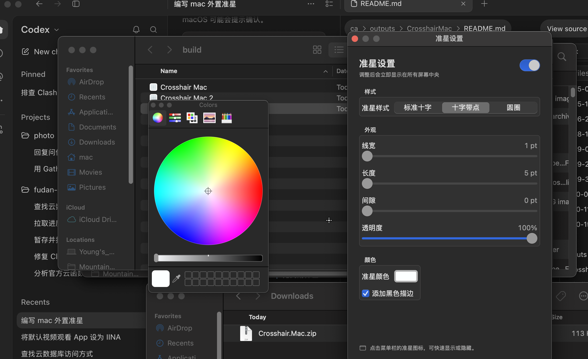

# Crosshair Mac

一个 macOS 菜单栏外置准星，参考了 [liang-weixi/crosshair-tool](https://github.com/liang-weixi/crosshair-tool) 的功能设计，并使用 Swift、SwiftUI 和 AppKit 原生实现。

## 实际使用截图



## 功能

- 在每台显示器的屏幕中心显示透明、鼠标穿透的置顶准星
- 标准十字、中心点十字、圆圈三种样式
- 调整线宽、长度、间隙、颜色、透明度和黑色描边
- 菜单栏快速显示/隐藏；设置自动保存
- 支持 macOS 13 或更新版本，通用版同时支持 Apple Silicon 和 Intel Mac

## 运行

需要安装 Xcode Command Line Tools。在本目录运行：

```sh
swift run
```

应用启动后会出现在菜单栏。点击准星图标打开菜单和设置。

## 打包为 `.app`

```sh
./package-app.sh
```

生成的通用版应用位于 `build/Crosshair Mac.app`，下载包位于 [`build/Crosshair Mac.zip`](build/Crosshair%20Mac.zip)。通用包包含 Apple Silicon（arm64）和 Intel（x86_64）版本。

## Release 的签名与首次打开

仓库中的 ZIP 是未经过 Apple 公证的构建包。当前应用使用临时（ad-hoc）签名，没有可供 Gatekeeper 验证的开发者身份，因此从网上下载后可能无法直接双击打开。面向其他人正式分发时，需要用自己的 **Developer ID Application** 证书签名，并提交 Apple 公证。单独运行 `codesign --sign -` 只会生成临时签名，不能替代 Developer ID 签名或公证。

### 只在自己的 Mac 上运行

如果确认应用来自本仓库，可以在 Finder 中按住 Control 点击 `Crosshair Mac.app`，选择“打开”，并在提示框再次确认。也可以在“系统设置 → 隐私与安全性”中找到被拦截的应用并选择“仍要打开”。

如果系统仍拦截，可在终端执行下面的命令。它只移除本机下载文件上的隔离标记，不会给应用签名，也不会让其他人的 Mac 信任该应用：

```sh
xattr -dr com.apple.quarantine "/Applications/Crosshair Mac.app"
open "/Applications/Crosshair Mac.app"
```

只有在确认下载来源可信后才使用这种本机放行方式。

### 用自己的 Developer ID 签名并公证后分发

这条流程适合把应用发给其他 Mac 用户。你需要加入 Apple Developer Program，并在开发者账户中创建 **Developer ID Application** 证书。普通的自签名证书或 ad-hoc 签名不能让陌生用户的 Gatekeeper 自动信任应用。

1. 安装 Xcode Command Line Tools，并在“钥匙串访问”中安装 Developer ID Application 证书及其私钥。先确认证书可用：

   ```sh
   security find-identity -v -p codesigning
   ```

   从输出中复制完整的 `Developer ID Application: 名字 (TEAM_ID)` 身份字符串。若列表中没有该身份，先从 Apple Developer 账户创建并安装 Developer ID Application 证书。

2. 下载并解压仓库中的 `Crosshair Mac.zip`。在终端进入解压目录，设置应用路径和签名身份，然后签名并检查签名：

   ```sh
   APP="$PWD/Crosshair Mac.app"
   IDENTITY="Developer ID Application: Your Name (TEAM_ID)"

   codesign --force --options runtime --timestamp --sign "$IDENTITY" "$APP"
   codesign --verify --deep --strict --verbose=2 "$APP"
   ```

   把 `IDENTITY` 的示例文字替换成上一步查到的完整身份。不要把证书私钥提交到仓库。

3. 为 Apple 公证准备凭据。到 Apple ID 账户生成一个**专用密码**，不要使用 Apple ID 登录密码。将占位内容替换成自己的 Apple ID 邮箱、Team ID 和专用密码：

   ```sh
   xcrun notarytool store-credentials "CrosshairMacNotary" \
     --apple-id "your-apple-id@example.com" \
     --team-id "TEAM_ID" \
     --password "APP_SPECIFIC_PASSWORD"
   ```

   该命令会把公证凭据保存在本机钥匙串中。不要把专用密码写入 README、脚本或 Git 提交。

4. 将已签名应用打包并提交公证，等待 Apple 返回结果：

   ```sh
   ditto -c -k --keepParent "$APP" "$PWD/Crosshair-Mac-notarization.zip"
   xcrun notarytool submit "$PWD/Crosshair-Mac-notarization.zip" \
     --keychain-profile "CrosshairMacNotary" --wait
   ```

   只有公证结果为 `Accepted` 才继续。若被拒绝，可查看公证日志并按错误修复后重新提交：

   ```sh
   xcrun notarytool log REQUEST_ID \
     --keychain-profile "CrosshairMacNotary"
   ```

5. 将公证票据装订到应用中，验证 Gatekeeper 评估结果，再生成要上传到 GitHub Release 的 ZIP：

   ```sh
   xcrun stapler staple "$APP"
   xcrun stapler validate "$APP"
   spctl --assess --type execute --verbose=2 "$APP"
   ditto -c -k --sequesterRsrc --keepParent \
     "$APP" "$PWD/Crosshair Mac.zip"
   ```

   将新生成的 `Crosshair Mac.zip` 上传为 GitHub Release 附件。这样下载者安装后，Gatekeeper 可以验证 Developer ID 签名和公证票据。

## 说明

准星窗口使用系统置顶窗口级别和全屏辅助行为。部分独占全屏游戏、受保护内容或启用了特殊反作弊限制的应用可能不允许第三方窗口叠加；这类游戏可尝试使用无边框窗口模式。
